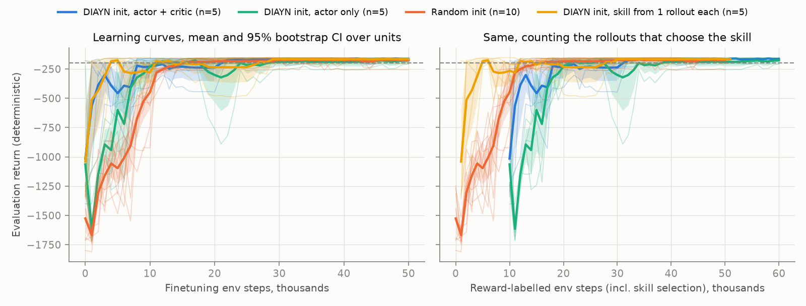

# DIAYN policy initialization: what our seeded re-run adds

Paper: Eysenbach et al., *Diversity is All You Need* (ICLR 2019), arXiv 1802.06070, Section 4.2.1 and Figure 5.

## The claim we tested

> "On all tasks, unsupervised pretraining enables the agent to learn the benchmark task more quickly."

- **Method.** Take the DIAYN skill with the highest task reward, initialize both the policy and the value networks from it, and finetune with SAC on the task reward. Compare with the same networks trained from random initialization.
- **Paper's evidence.** Figure 5: HalfCheetah, Hopper and Ant, averaged over 5 seeds. It shows no error bars or tests, and it does not count the pretraining or the rollouts used to choose the skill.
- **Second claim.** Initializing the critic as well as the actor "further sped up learning". The paper's reason is that the pseudo-reward is close to the task reward for the best skill.

## What we ran

| | |
|---|---|
| Environment | Pendulum-v1 (Gymnasium). It is not in Figure 5; its settings (5 skills, 32-unit networks) come from the authors' launcher code. We chose it to fit a CPU budget of a few hours. |
| Pretraining | 5 independent DIAYN runs, 1M steps each, reused from our earlier reproduction |
| Arms | DIAYN init with actor + critic (the paper's method); DIAYN init with actor only; random init. A follow-up arm picks the skill more cheaply (see insight 5) |
| Runs | 2 finetuning runs per pretrained seed for each DIAYN arm (10 runs, 5 independent units); 10 random-init runs |
| Finetuning | 50k steps, SAC with the pretraining hyperparameters (α = 0.1), fresh optimizer, empty replay buffer |
| Evaluation | Deterministic policy, 10 fixed start states shared by every run, after every 1,000 steps |
| Statistics, fixed before the runs | **Primary:** area under the learning curve (AUC), one-sided Welch t-test. **Secondary:** Holm-corrected. Reported with Hedges' g and 95% bootstrap CIs. **Unit of analysis:** the pretrained seed |


*Left: mean and 95% bootstrap CI of the evaluation return during finetuning; thin lines are single units. Right: the same curves when the reward-labelled rollouts spent choosing the skill are counted. Dashed line: return −200 ("solved").*

## Headline numbers

| Metric (DIAYN actor + critic vs random) | DIAYN | Random | Difference [95% CI] | Test |
|---|---|---|---|---|
| **AUC over 50k steps (primary)** | −234 | −369 | **+134 [103, 175]** | g = 4.1, p = 0.0006 |
| Median steps to reach −200 | 1.5k | 13.5k | −12.4k [−19.1k, −5.9k] (means) | Holm p = 0.06 |
| Return after 5k steps | −456 | −1097 | +640 [452, 843] | Holm p = 0.003 |
| Final return (last 5k steps) | −163 | −173 | +9 [−7, 31] | n.s. |
| AUC counting the 10k selection steps | | | **−59 [−96, −11]** | DIAYN worse |
| Same, skill chosen from 1 rollout per skill (1k steps), follow-up | | | **+119 [80, 160]** | g = 3.3, Holm p = 0.02 |

## Insights for the poster

**1. The claim reproduces, with a large effect, and now with error bars.**
On Pendulum, DIAYN initialization reaches the solved level about 9× sooner (median 1.5k vs 13.5k steps). The primary test is significant with 5 independent pretrained seeds (p = 0.0006, g = 4.1).
*Poster line:* "Policy initialization from DIAYN speeds up learning: median 1.5k vs 13.5k steps to solve Pendulum (5 pretraining seeds, p < 0.001)."

**2. Faster, not better.**
Every run in every arm solves the task, and final returns are the same (+9 [−7, 31]). DIAYN changes how fast the policy learns, not where it ends up. This matches the paper's wording ("more quickly") and is worth stating explicitly, because Figure 5 can be read as higher returns too.

**3. The speed-up is not just a good starting policy.**
In 4 of 5 pretrained seeds, the chosen skill starts at a return of −1000 to −1340, far from solving the task. Yet after only 1,000 finetuning steps the median DIAYN run is at −230. Only one seed's skill (−179) already solved the task before finetuning. So the pretrained weights carry structure that finetuning exploits quickly, beyond the behaviour the skill already shows.

**4. Transferring the critic matters, but not for the paper's stated reason.**
- **Actor only is fragile.** Pairing the pretrained actor with a fresh critic destroys it: the return falls from about −1200 to −1650 in the first 1,000 steps, before recovering. Actor-only runs still solve faster than random init (median 8k vs 13.5k steps).
- **Actor + critic beats actor only.** AUC is 87 higher [29, 146] (p = 0.017 unadjusted; Holm p = 0.24 across 23 secondary tests). This is suggestive, not conclusive, with 5 seeds.
- **The transferred critic is badly miscalibrated.** It starts at V ≈ +132, because the DIAYN pseudo-reward log q(z|s) − log p(z) is positive (at most log 5 per step). Pendulum's task reward is always negative. V stays positive for more than 20k steps (median +40 after 10k, +14 after 20k), while the policy is near-solved from about 8k steps.
- **So the critic seems to help by its shape, not its values.** Its relative values give the actor sensible gradients even though their scale and sign are wrong. The paper's argument, that the pseudo-reward is "close to the true task reward", does not hold in scale here, so it cannot fully explain the benefit. A hypothesis to test, not a proven mechanism.

**5. Choosing the skill has a hidden cost, but a cheap choice keeps the advantage.**
- **The cost.** Picking "the skill with highest reward" needs reward-labelled rollouts, which the paper does not count. With the evaluation protocol of the authors' code (10 rollouts per skill), that is 5 × 10 × 200 = 10k steps on Pendulum.
- **Counted at that price, the advantage reverses.** DIAYN is *worse* than random init (AUC −59 [−96, −11]), because random init learns Pendulum in about as many steps as the selection costs.
- **A cheap selection restores it.** We added this follow-up after seeing the result above. Choosing the skill from a single rollout per skill costs 1k steps.
  - It picked the same skill in 7 of 10 runs.
  - It learned as fast as the 10-rollout choice (AUC +8 [−42, 57]; median 1k steps to solve).
  - It beat random init with the cost counted: AUC +119 [80, 160], g = 3.3, Holm p = 0.02.
- **The lesson.** Selection cost is a real term in the comparison, and on easy tasks it decides the outcome. Ten rollouts per skill is far more than needed.



*Right panel: counting reward-labelled steps, the 10-rollout DIAYN arms (blue, green) start 10k steps late and lose to random init (orange). The 1-rollout arm (amber) starts 1k steps late and still wins.*

*Poster line:* "Choosing the skill costs reward-labelled steps that the paper ignores. With the authors' 10-rollout protocol this cost erases the gain on Pendulum; choosing from one rollout per skill keeps it (+119 AUC, p = 0.02)."

**6. The unit of replication is the pretraining run, not the finetuning seed.**
Pretrained seeds differ enormously: the best skill's return ranges from −211 to −1293 across the 5 seeds. Treating each finetuning run as independent would double our n and overstate significance. We average finetuning repeats within a pretrained seed. The paper's "5 random seeds" doesn't say which of the two it varied.

## Caveats

- **One environment, and an easy one.** Pendulum is not in Figure 5, and random init solves it in about 13k steps. Whether the selection cost reverses the result elsewhere depends on how it compares with learning time. On the Figure 5 tasks, the same protocol (50 skills × 10 rollouts × 1,000 steps) costs up to **500k** reward-labelled steps, half of Figure 5's 1M-step x-axis. So insight 5 is likely relevant to Figure 5 too, but we have not tested it there.
- **Five independent units.** We can detect large effects only. The critic comparison (insight 4) needs more pretrained seeds to be conclusive.
- **Different software stack.** We used Gymnasium 1.x and a PyTorch re-implementation (SAC v1 with a GMM policy, as the authors' code), not the original gym/rllab/TensorFlow stack.
- **Choices the paper leaves unspecified.** Pretraining length (1M steps), the evaluation protocol, and resetting the optimizer and replay buffer before finetuning were our choices.

## Reproduce

```bash
python finetune_sweep.py --pretrain_root results/pendulum/default --out results/pendulum/finetune --jobs 8 --n_epochs 50
python finetune_sweep.py --pretrain_root results/pendulum/default --out results/pendulum/finetune_sel1 --inits diayn --jobs 8 --n_epochs 50 --select_rollouts 1
python finetune_stats.py results/pendulum/finetune --out figures/pendulum-finetune
python finetune_stats.py results/pendulum/finetune results/pendulum/finetune_sel1 --out figures/pendulum-finetune-sel1
```

The main sweep (30 runs) takes about 25 min and the follow-up (10 runs) about 10 min, on an 8-core CPU. The last two commands write the full test tables: `figures/pendulum-finetune/tests.csv` (main family) and `figures/pendulum-finetune-sel1/tests.csv` (adds the follow-up comparisons as a separate Holm family, so the main family's numbers are unchanged).
