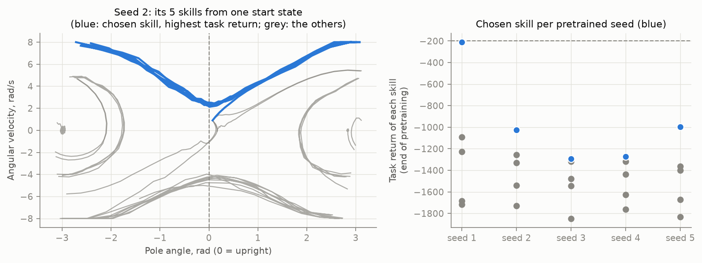
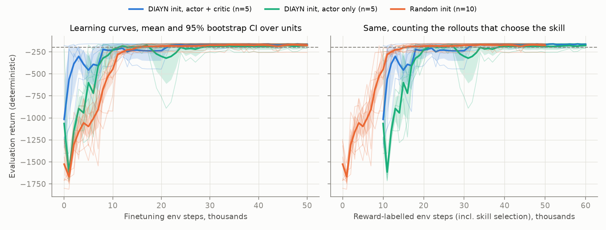
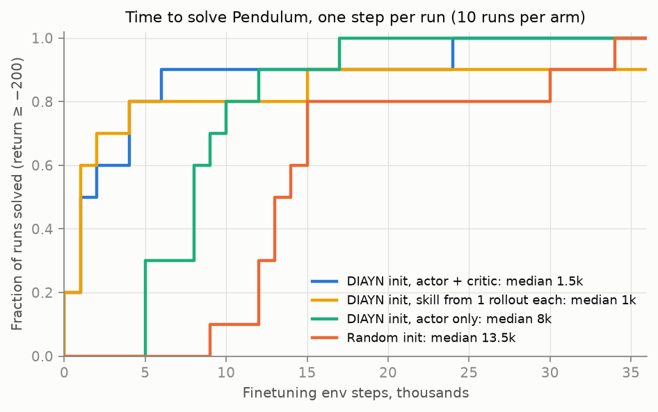
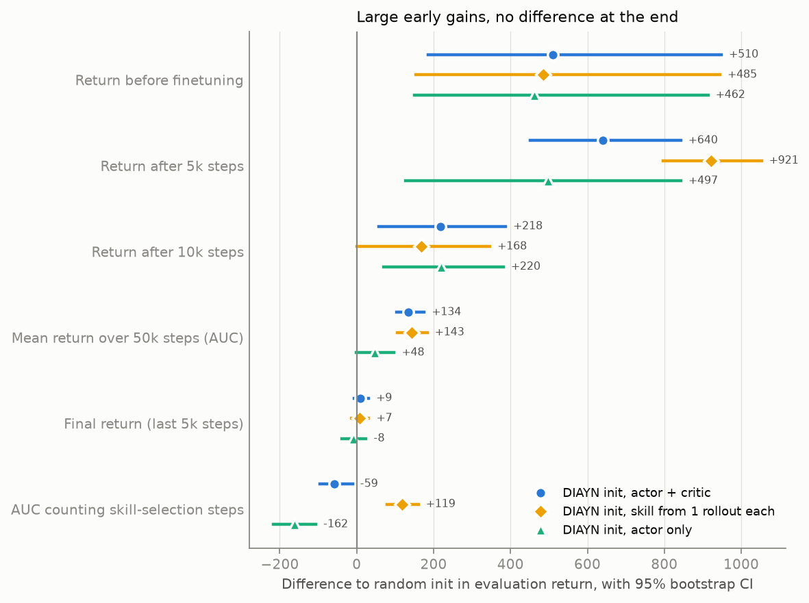
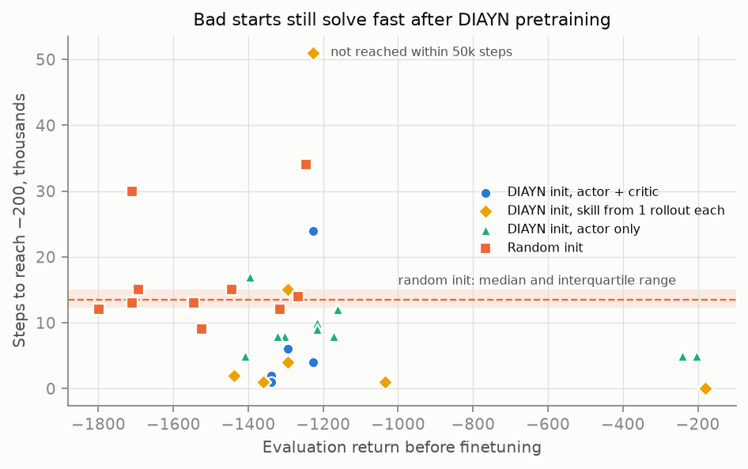
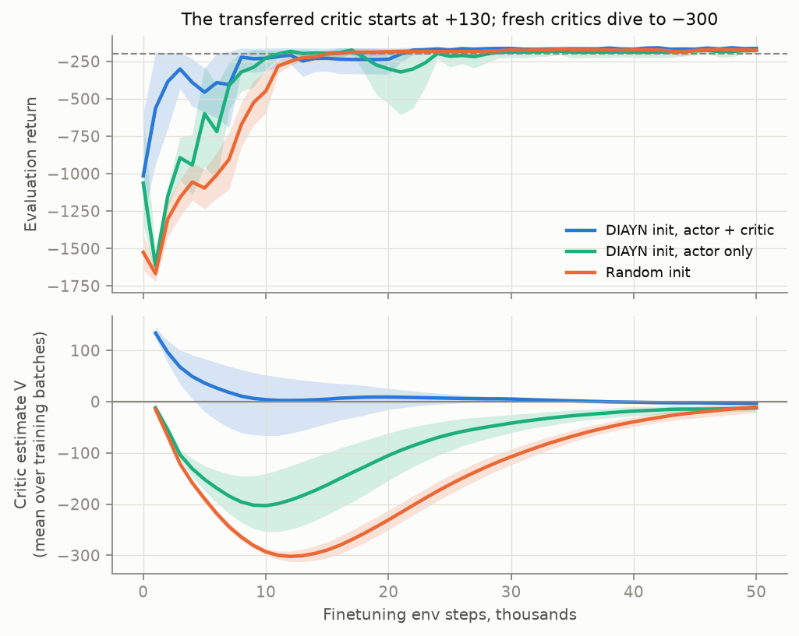
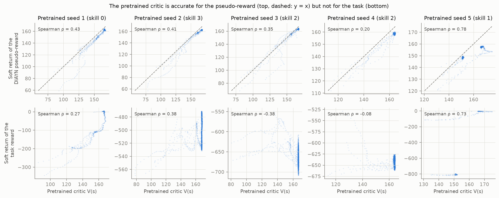
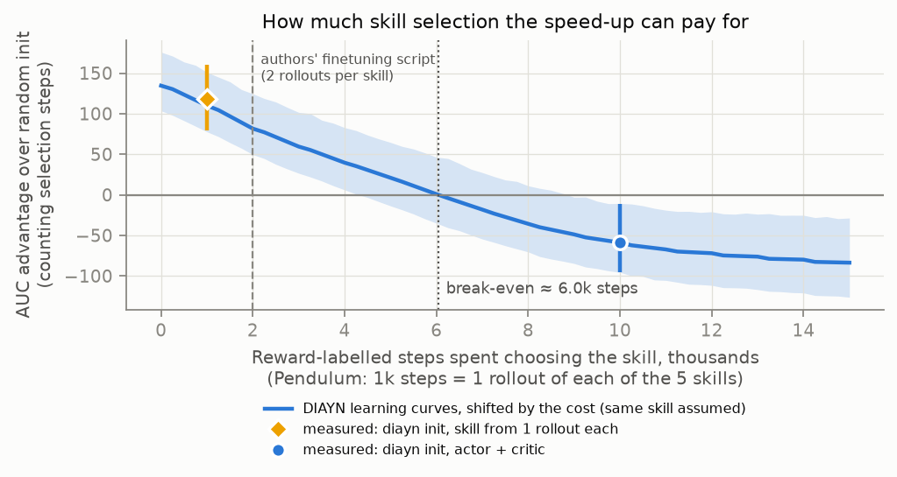
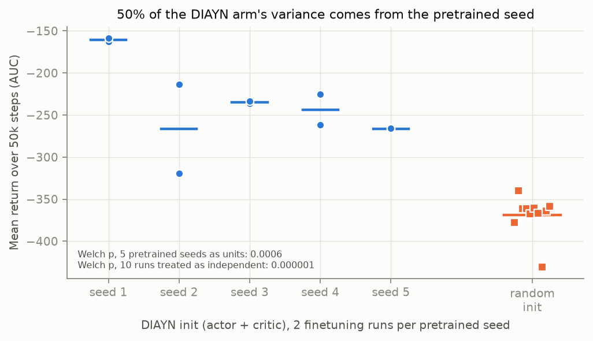

# DIAYN policy initialization: what our seeded re-run adds

Paper: Eysenbach et al., *Diversity is All You Need* (ICLR 2019), arXiv 1802.06070, Section 4.2.1 "Accelerating learning with policy initialization", Figure 5.

## Terminology

| Term | Meaning here |
|---|---|
| **Step** | One action taken in the environment, and the observation and reward that come back. |
| **Episode** | One attempt at the task from a start state until the time limit: 200 steps on Pendulum. |
| **Rollout** | Running a fixed policy (here, one skill) for one episode, only to *measure* it, without learning from it. Each rollout costs env steps and, since we read the task reward, **reward-labelled** steps. |
| **Epoch** | 1,000 training steps (the authors' unit). Figure 5's x-axis goes up to 1,000 epochs = 1M steps. |
| **Skill z** | DIAYN learns one policy conditioned on a skill index z (5 skills on Pendulum, 50 on the locomotion tasks). Each z gives a different behaviour. |
| **Pseudo-reward** | DIAYN's training signal, log q(z\|s) − log p(z): high when a discriminator q can tell from the state which skill is running. It never uses the task reward. |
| **Pretraining / finetuning** | Pretraining: DIAYN learns skills with the pseudo-reward. Finetuning: one skill is trained further with SAC on the task reward. |
| **Actor / critic** | The actor is the policy that picks actions. The critics estimate future reward: Q(s, a) and V(s) in SAC v1. |
| **SAC and α (alpha)** | Soft Actor-Critic maximizes reward **+ α × entropy**. Entropy measures how random the policy is, so **α sets how much the agent is paid to stay random**. A large α gives more exploration but noisier behaviour; a small α gives more exploitation. In DIAYN pretraining, α = 0.1 balances diverse behaviour against skills the discriminator can tell apart. Scaling the reward by c is equivalent to using α = 1/c, which is how the authors' code sets it (`scale_reward`). |
| **Return** | Sum of rewards over an episode. On Pendulum it ranges from about −1,800 (spinning or hanging) to about −150 (balanced upright). We call **−200** "solved". |
| **Deterministic evaluation** | Measuring the policy without its randomness (the most likely action), from 10 fixed start states shared by every run. |
| **AUC** | Area under the learning curve: the mean evaluation return over all finetuning checkpoints. It rewards both learning early and ending high. |
| **Unit** | One independent replicate. For DIAYN arms this is the **pretrained run**: finetuning runs from the same pretrained weights are averaged, not counted separately. |
| **Statistics** | **Welch t-test:** compares two means without assuming equal variances. **Hedges' g:** the difference in standard deviations (≥ 0.8 is "large"). **95% bootstrap CI:** an interval from resampling the units. **Holm correction:** adjusts p-values when many tests are run. **ICC:** the share of variance due to the group, here the pretrained seed. **Spearman ρ:** rank correlation, from −1 to 1. |

## The claim

> "On all tasks, unsupervised pretraining enables the agent to learn the benchmark task more quickly."

The method:
1. Pick the DIAYN skill with the highest task reward.
2. Initialize the policy **and** the value networks from it.
3. Finetune with SAC on the task reward.

The comparison is with the same networks trained from random initialization. Figure 5 shows HalfCheetah, Hopper and Ant over 5 seeds, with no error bars or tests. Pretraining is not counted, and the rollouts used to choose the skill are not mentioned. A second claim: initializing the critic as well "further sped up learning", because "the pseudo-reward was close to the true task reward for the best skill".

## What we ran, and how it relates to the paper

We ran the experiment of Section 4.2.1 on **Pendulum**, not on the three Figure 5 tasks. Pretraining those for 5 seeds would take days of CPU time; Pendulum takes minutes. The authors' repository has a dedicated finetuning script (`examples/mujoco_all_diayn_finetune.py`) with a Pendulum entry, so Pendulum is a setting the authors prepared, though not one they report.

| | Paper text (Sec. 4.2.1, App. C) | Authors' finetuning script | **Ours** |
|---|---|---|---|
| Tasks | HalfCheetah, Hopper, Ant | Pendulum, Hopper, HalfCheetah, Ant entries | **Pendulum** |
| Pretraining | not specified | Pendulum: 5 skills, 32-unit networks, 1,000 epochs | **same** (reused from our DIAYN reproduction, 5 seeds) |
| Skill chosen | "the skill with highest reward" | best of **2 rollouts per skill** | best of the pretraining's last evaluation, **10 rollouts per skill**; follow-up: **1 new rollout per skill** |
| Networks transferred | policy **and** value networks | policy; Q and V only if `use_pretrained_values=True` (**default off**) | **both settings**: actor + critic (paper text) and actor only (code default) |
| Finetuning | SAC on the task reward | SAC on the env reward, no discriminator, new replay buffer and optimizer | **same** |
| Entropy weight α | "α = 0.1 … for all experiments" | effective **α = 1** (`scale_reward = 1`; Ant 1/3) | **α = 0.1** (paper text). **Differs from the code** |
| Length | Figure 5 up to 1,000 epochs (1M steps) | Pendulum **50 epochs** | **50 epochs** (50k steps) |
| Network size | 300 units | Pendulum 32 | **32** |
| Random-init baseline | same architecture, random weights | not in the finetuning script | same networks (including the skill input), random weights |
| Seeds | 5 | seed 1 by default | 5 pretrained seeds × 2 finetuning runs; 10 random-init runs |
| Pretraining on the x-axis | omitted | n/a | omitted (left panels); a second panel counts the skill-selection steps |

**What carries over:** the method (best skill, actor + critic transfer, SAC on the task reward, compared with random init) and the qualitative claim ("learns more quickly").

**What doesn't:** the numbers and the curve shapes. On Pendulum, SAC from scratch solves the task in about 13k steps. The whole effect therefore happens in the first 10–15k steps, after which all curves merge. In Figure 5, learning takes the full 1M steps, so the curves stay apart for longer.

**Untested deviation:** the entropy weight. The paper text says α = 0.1 and we used that, but the authors' finetuning script effectively uses α = 1. A rerun with α = 1 would remove this doubt (about 25 min).

**The analysis, fixed before the runs:**
- Primary test: AUC of DIAYN (actor + critic) vs random, one-sided Welch.
- All other comparisons are Holm-corrected.
- The 1-rollout selection arm was added *after* we saw the main results. It is analyzed as a separate family and should be read as exploratory.

## Headline numbers

| Metric (DIAYN actor + critic vs random) | DIAYN | Random | Difference [95% CI] | Test |
|---|---|---|---|---|
| **AUC over 50k steps (primary)** | −234 | −369 | **+134 [103, 175]** | g = 4.1, p = 0.0006 |
| Median steps to reach −200 | 1.5k | 13.5k | −12.4k [−19.1k, −5.9k] (means) | Holm p = 0.06 |
| Return after 5k steps | −456 | −1097 | +640 [452, 843] | Holm p = 0.003 |
| Final return (last 5k steps) | −163 | −173 | +9 [−7, 31] | n.s. |
| AUC counting 10k selection steps (10 rollouts per skill) | | | −59 [−96, −11] | DIAYN worse |
| AUC counting 2k selection steps (the authors' 2 rollouts per skill)\* | | | +82 [49, 124] | DIAYN better |
| AUC counting 1k selection steps (1 rollout per skill, follow-up) | | | +119 [80, 160] | g = 3.3, Holm p = 0.02 |

\* Computed from the 10-rollout arm's learning curves, assuming 2 rollouts would pick the same skill (1 rollout picked the same skill in 7 of 10 runs).

## Figures and insights

### Background: what is being transferred


The left panel shows one pretrained seed's 5 skills from the same start state. The skill with the highest task return (blue) **spins the pendulum through the upright position**. It scores badly (−1,025) because it never stops, but it already contains the hard part, the swing-up. The right panel shows that the chosen skill solves the task in only 1 of 5 seeds.

### 1. The claim reproduces on Pendulum, with a large effect



DIAYN initialization reaches −200 about **9× sooner** (median 1.5k vs 13.5k steps; p = 0.0006, g = 4.1, 5 pretrained seeds).

*Poster line:* "Initializing from a DIAYN skill speeds up learning: median 1.5k vs 13.5k steps to solve Pendulum (5 pretraining seeds, p < 0.001)."

### 2. Faster, not better


The gains are large early (+640 return after 5k steps) and vanish by the end (final return +9 [−7, 31]). Every run in the main experiment solves the task. DIAYN changes how fast learning happens, not where it ends, which matches the paper's wording ("more quickly").

### 3. The speed-up is not just a good starting policy


In 4 of 5 pretrained seeds, the chosen skill starts as badly as random initialization (−1,000 to −1,340). Yet 7 of those 8 finetuning runs reach −200 within 1k–6k steps (the eighth took 24k), against a median of 13.5k for random init. What transfers is behaviour that finetuning can quickly repair (like the spinning skill above), not a policy that already scores well.

One run of the follow-up arm never reached −200 within 50k steps (top of the figure). It still learned faster than random init on average.

### 4. Transferring the critic helps, but not because it knows the task



- **Actor only is fragile.** With a fresh critic (the default in the authors' code), the pretrained actor collapses in the first 1,000 steps (from about −1,200 to −1,650) before recovering. It still solves faster than random init (median 8k vs 13.5k steps).
- **Actor + critic beats actor only:** AUC +87 [29, 146] (p = 0.017 unadjusted, Holm p = 0.24). The direction is consistent, but 5 seeds are not enough to be conclusive.
- **The transferred critic doesn't know the task.** Along its own skill's rollouts, the pretrained V matches the pseudo-reward return (top row: points near y = x). Against the task return it is uninformative:
  - its sign and scale are wrong (about +160, against true task values of −20 to −660);
  - it ranks states inconsistently across seeds (Spearman ρ from −0.38 to +0.73);
  - on the states visited most, it is almost constant.
- **So the paper's explanation does not hold here.** It credits a pseudo-reward "close to the true task reward", but on Pendulum the pseudo-reward is always positive and the task reward always negative.
- **Our hypothesis (not tested).** A fresh critic is wrong in a *destructive* way: its estimates dive to −300 and its gradients wreck the pretrained actor. The pretrained critic is wrong in a *flat, harmless* way, which gives the new value estimates time to form.

*Poster line:* "Transferring the critic helps, but the pretrained critic carries no task information (Spearman ρ from −0.38 to 0.73 with the true task value). Its benefit may be that it doesn't damage the pretrained actor."

### 5. Choosing the skill has a cost the paper doesn't count


- **What it costs.** Choosing "the skill with highest reward" requires rollouts that read the task reward, and the cost depends on the protocol:
  - 10 rollouts per skill (the evaluation our pretraining logged): 10k steps on Pendulum;
  - 2 rollouts per skill (the authors' finetuning script): 2k steps;
  - 1 rollout per skill (our follow-up): 1k steps.
- **Break-even at about 6k steps.** Above that, random init wins on Pendulum. At the authors' 2k, DIAYN keeps a clear advantage (+82 [49, 124]); at 10k it loses (−59 [−96, −11]).
- **Cheap selection loses nothing.** One rollout per skill picked the same skill in 7 of 10 runs and learned as fast (AUC +8 [−42, 57] vs 10 rollouts).
- **On the Figure 5 tasks, the authors' protocol costs 50 skills × 2 × 1,000 = 100k steps**, 10% of a 1M-step run. Whether that matters depends on how much earlier DIAYN gets there, which we have not measured.

*Poster line:* "Selecting the skill isn't free. On Pendulum the speed-up pays for up to about 6k selection steps; the authors' 2-rollout protocol (2k) is within budget, a 10-rollout one is not."

### 6. Replicate pretraining, not just finetuning


Half of the DIAYN arm's variance (ICC = 0.50) comes from *which pretrained run* is used. Treating the 10 finetuning runs as independent would report p = 1×10⁻⁶ instead of the correct p = 0.0006, overstating the evidence about 400-fold. The paper's "5 random seeds" doesn't say whether pretraining was repeated for each seed.

## Caveats

- **One environment, and an easy one.** Pendulum is not in Figure 5. The effect plays out in about 15k steps, and only 5 pretrained runs give independent evidence, so we can detect large effects only.
- **Entropy weight.** We used the paper's α = 0.1; the authors' finetuning script uses α = 1. This is untested.
- **Exploratory parts.** The 1-rollout arm, the critic-calibration analysis and the selection-cost curve were defined after the main results.
- **Software stack.** We used Gymnasium 1.x and a PyTorch re-implementation of the authors' SAC v1 with a GMM policy, not the original TensorFlow/rllab code.

## Reproduce

```bash
python finetune_sweep.py --pretrain_root results/pendulum/default --out results/pendulum/finetune --jobs 8 --n_epochs 50
python finetune_sweep.py --pretrain_root results/pendulum/default --out results/pendulum/finetune_sel1 --inits diayn --jobs 8 --n_epochs 50 --select_rollouts 1
python finetune_stats.py results/pendulum/finetune --out figures/pendulum-finetune
python finetune_stats.py results/pendulum/finetune results/pendulum/finetune_sel1 --out figures/pendulum-finetune-sel1
python poster_figures.py --out docs/img
```

On an 8-core CPU, the main sweep (30 runs) takes about 25 min, the follow-up (10 runs) about 10 min, and the figures under a minute. The test tables are written to `figures/pendulum-finetune/tests.csv` and `figures/pendulum-finetune-sel1/tests.csv`.
